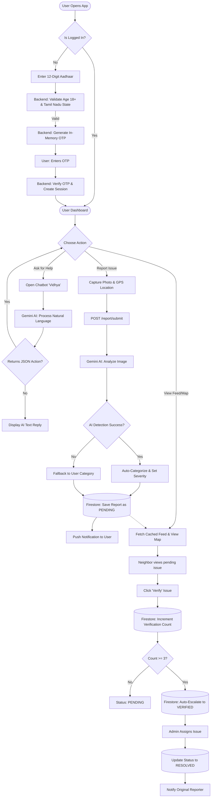

# Civic-App: End-to-End System Flow

This flowchart represents the entire lifecycle of the Civic-App, simplified for better visibility and readability.

### Key Stages Explained
1. **Authentication (Top):** Validates the user's Aadhaar details (Age/State) before sending an OTP.
2. **AI Chatbot (Left):** "Vidhya" processes text and either replies normally or triggers an app navigation action.
3. **AI Reporting (Center):** The core feature where Gemini automatically categorizes the civic issue based on the uploaded photo.
4. **Community Verification (Right):** The crowdsourcing engine where 3 verifications automatically escalate the report to the authorities.
