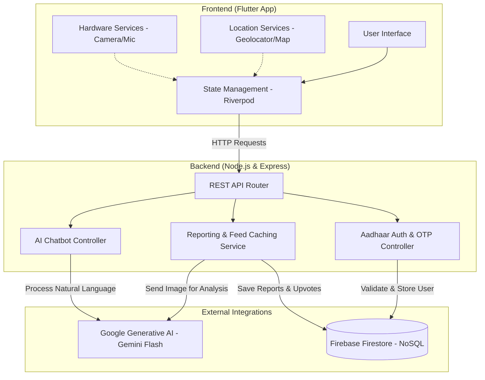
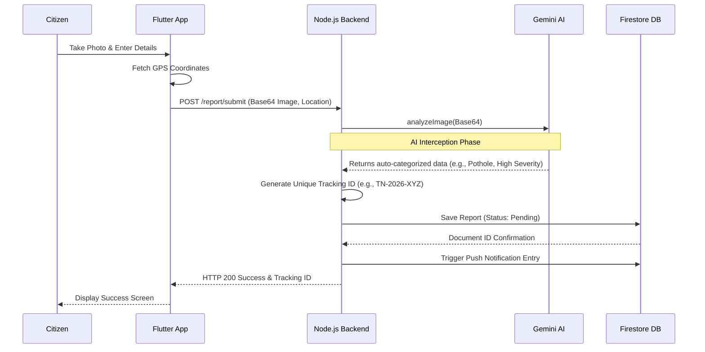
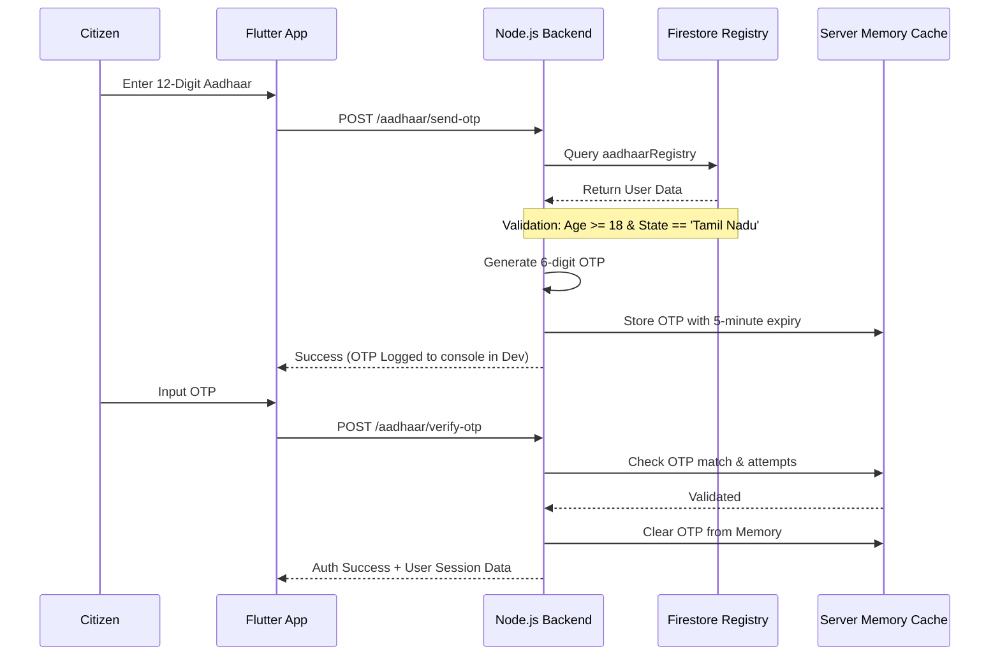
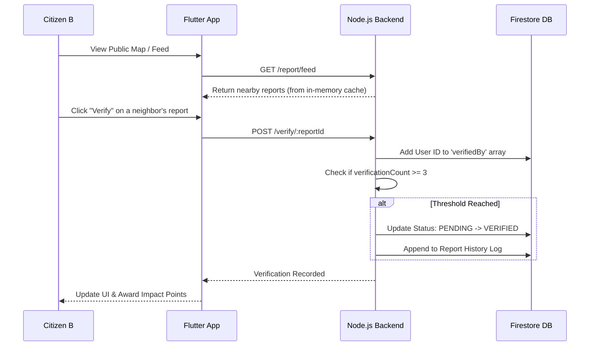

# Civic-App: Architecture and Flow Diagrams

These diagrams use Mermaid to visualize the architecture and data flows of your project. They are extremely useful for system design rounds in interviews. You can draw these on a whiteboard or explain them conceptually.

## 1. High-Level System Architecture

This diagram shows the core components of the system and how they interact.

---

## 2. Issue Reporting & AI Analysis Flow

This sequence diagram illustrates exactly what happens from the moment a user clicks "Submit" to when the report is saved.

---

## 3. Aadhaar Authentication Flow (Simulated)

This sequence diagram shows the logic used to verify trust and limit access to valid, 18+ Tamil Nadu residents.

---

## 4. Community Verification (Crowdsourcing) Flow

How reports escalate statuses automatically without admin intervention.

